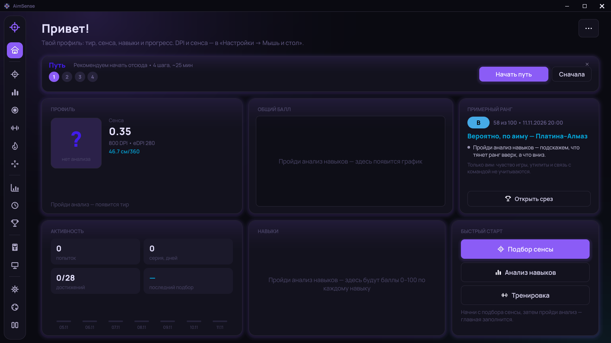
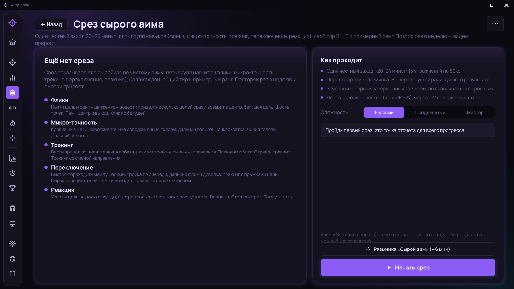
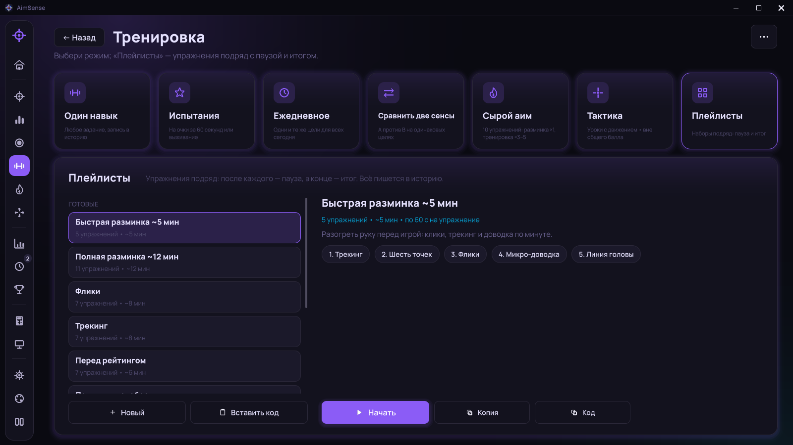
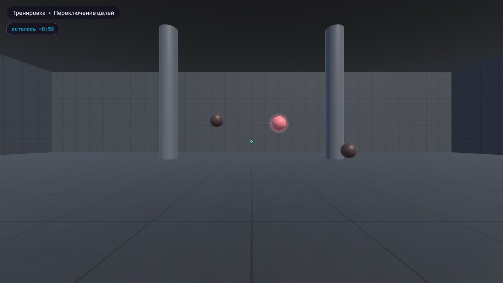
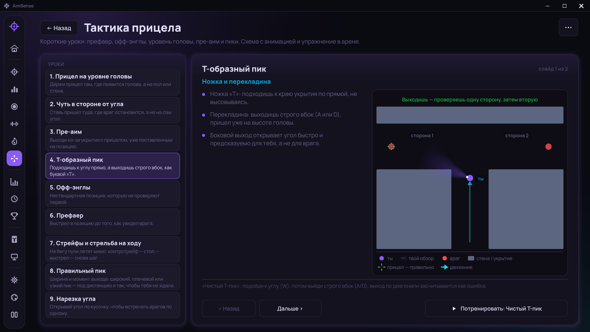
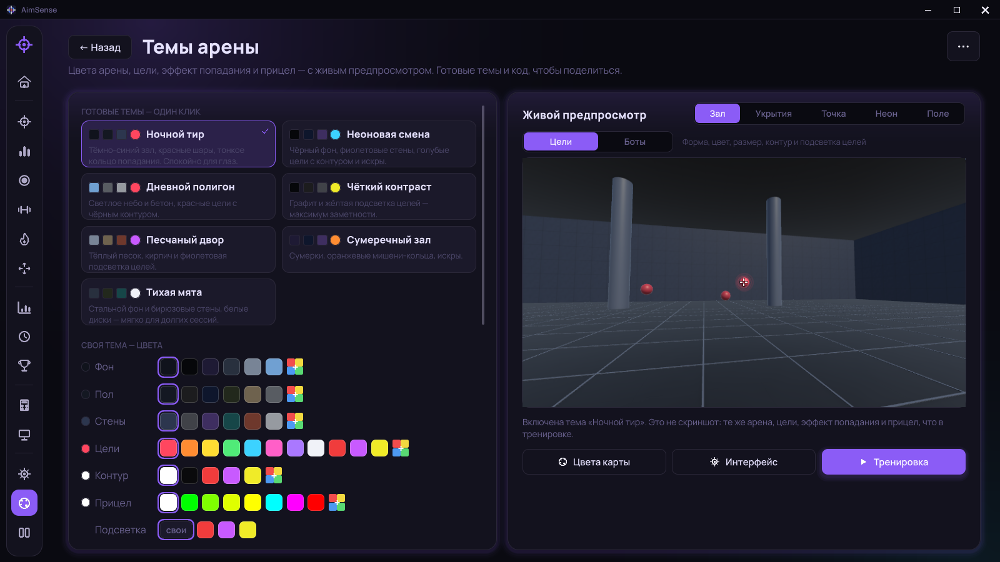

# AimSense

**Тренер аима и подбора чувствительности мыши для шутеров.**

Автор: **silevril — Бубнова Виктория**

AimSense считает сантиметры на полный оборот, проводит упражнения на точность и предлагает сенсу, с которой попадания стабильнее. Ввод мыши — сырая дельта, без сглаживания.

В этом репозитории только официальные установщики. Исходного кода здесь нет.

## Скачать

**[Скачать AimSense 0.4.2](https://github.com/silevril/AimSense-Releases/releases/download/v0.4.2/AimSense_Unity_Setup_0.4.2.exe)** — актуальная версия ([страница релиза](https://github.com/silevril/AimSense-Releases/releases/tag/v0.4.2)).

| Версия | Установщик |
|---|---|
| AimSense 0.4.2 | [AimSense_Unity_Setup_0.4.2.exe](https://github.com/silevril/AimSense-Releases/releases/download/v0.4.2/AimSense_Unity_Setup_0.4.2.exe) |

Рядом с установщиком лежит файл `.sha256` с контрольной суммой.

> **Антивирус или Windows может ругаться** — это ложное срабатывание: у программы пока нет платной цифровой подписи, и её скачивает немного людей. Как проверить файл и что нажать в SmartScreen, Defender, ESET, Kaspersky и других антивирусах — в инструкции **[ANTIVIRUS.md](ANTIVIRUS.md)**.

## Возможности

- **Подбор сенсы.** Парные попытки на двух значениях, сужение диапазона и итоговая сенса в сантиметрах на 360°.
- **Анализ навыков.** Реакция, флики, микрокоррекции, трекинг, переключение целей и другие задания. В конце — балл, слабые места и короткий разбор.
- **Срез сырого аима и примерный ранг.** Пять групп навыков, общий балл, тир от S+ до E и ориентир по рангам Valorant.

- **Тренировка:** отдельные навыки, «Сырой аим» — 10 упражнений на каждый день, испытания, ежедневное задание и **плейлисты** — упражнения подряд с паузой и итогом.

- **Тактика прицела.** Короткие уроки с анимациями и упражнения к ним: пре-аим, пики, уровень головы, префаеры, стрейфы.

- **Темы арены** с живым 3D-предпросмотром: фон, пол, стены, цели, эффект попадания и прицел.

- **Проверка мыши и игры.** Замер DPI по движению мыши, частота опроса, ускорение указателя Windows и частота монитора.
- **Аналитика и история.** Сводка сессий, серии навыков, разбор движений мыши, путь прицела и тепловая карта промахов.
- **Видеоповторы** попыток, **подробный гайд по настройкам**, настройка **прицела**, **калькулятор сенсы** между играми и **гид по настройке Windows**.
- **Обновления внутри программы** и своя тёмная рамка окна.

## Системные требования

- Windows 10 или 11, 64-bit
- мышь; для замера DPI и опроса — та же мышь, которой вы играете

## Установка

1. Скачайте установщик актуальной версии по ссылке выше.
2. По желанию сверьте контрольную сумму с файлом `.sha256` (PowerShell):
   `Get-FileHash .\AimSense_Unity_Setup_0.4.2.exe -Algorithm SHA256`
3. Запустите установщик. Права администратора не нужны: программа ставится в `%LOCALAPPDATA%\Programs\AimSense`.
4. Запустите AimSense из меню «Пуск» или с ярлыка на рабочем столе.

Результаты и настройки хранятся в папке `Документы\AimSense`.

Если Windows SmartScreen предупредит о неизвестном издателе, нажмите «Подробнее» → «Выполнить в любом случае». Если антивирус удалил или заблокировал файл — см. [ANTIVIRUS.md](ANTIVIRUS.md). Скачивайте AimSense только отсюда.

## Автор и лицензия

© 2026 Бубнова Виктория (silevril). Все права защищены.

Можно скачать официальный установщик из раздела Releases этого репозитория и пользоваться программой лично. Перезаливать установщики в Telegram, Discord, на другие сайты и файлообменники, а также выкладывать репаки нельзя — делитесь ссылкой на эту страницу.

Полный текст — в файле [LICENSE](LICENSE).

## Отказ от ответственности

AimSense — независимый проект. Он не связан с Riot Games, не одобрен и не спонсируется ею. Valorant и Riot Games — товарные знаки или зарегистрированные товарные знаки Riot Games, Inc. Название игры упоминается только для пересчёта чувствительности; материалы Riot Games в программе не используются.

## Сообщить об ошибке

Ошибки и предложения — через [Issues](https://github.com/silevril/AimSense-Releases/issues). Не прикладывайте к сообщению личные файлы из папки с данными без необходимости.
